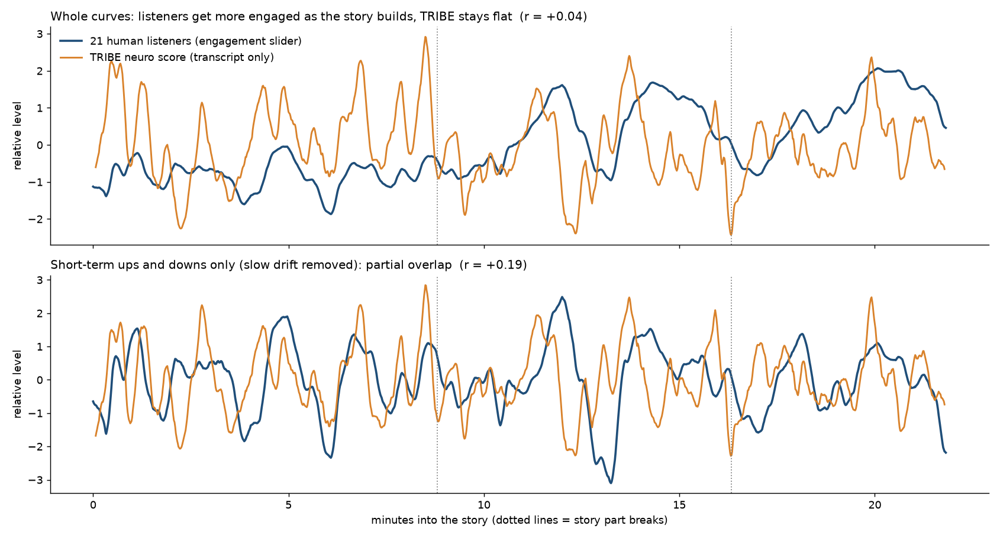

# What the neuro score measures: analysis record

Everything here was run on 10 October 2026 with TRIBE v2 (text pathway only: words and their
timings in, predicted fMRI on the fsaverage5 surface out, one prediction per second). The data
behind each number is in `data/`; the scripts are in `tools/`.

## Summary

| Question | Answer | Evidence |
|---|---|---|
| Does the score separate vivid text from bland text? | Yes, reliably | 25 of 25 topics, about 3 times higher |
| Does it need the text to make sense? | No | Scrambled word order scores higher in 17 of 25 topics |
| Do filler words lower it? | Barely | 15 of 25 topics |
| Does it track what real listeners find engaging? | No evidence | r = +0.04 over a 22-minute story, 21 listeners |
| Does it pick out the stronger moment within 30 seconds? | Slight edge | 60% against 50% chance, borderline |
| Does it agree with the app's speaking score? | No, it runs against it | Structured formal takes rank 2 to 18; a rambling one ranks 56 |

**Use it as** "predicted brain response" or "language vividness". **Do not use it as** an
engagement grade.

## The raw score

Mean predicted activity, averaged over the clip, in three sets of HCP-MMP1 regions (language,
social, auditory), then averaged across the three sets. Region lists are in
`api/neuro_core.py`.

## Test 1: calibration texts (25 topics, 4 versions each)

Each topic was written four ways, about 55 words each, and "spoken" at an even 150 words per
minute so delivery plays no part (`data/calibration_texts.py`):

- **engaging**: concrete, story-like, first person
- **flat**: the same subject in abstract, generic language
- **filler**: the flat version with "um", "you know" and similar inserted
- **scrambled**: the engaging version with the word order shuffled inside each sentence

| Version | Mean raw score |
|---|---|
| Engaging | 0.227 |
| Flat | 0.077 |
| Flat + filler | 0.067 |
| Scrambled | 0.266 |

| Comparison | Result (paired across topics) |
|---|---|
| Engaging vs flat | +0.150, t = +12.2, engaging higher in 25 of 25 |
| Engaging vs scrambled | −0.039, t = −3.1, engaging higher in 8 of 25 |
| Flat vs filler | +0.010, t = +1.9, flat higher in 15 of 25 |

Regions:

- **Higher for engaging than flat**: language and meaning regions along the superior temporal
  sulcus and inferior frontal cortex (IFSp, STSda, IFSa, 44, 47l, STSvp, STSva, STSdp, STGa),
  each in 100% of topics, t between +12 and +14.
- **Higher for scrambled than engaging**: dorsal visual and parietal attention regions (V7, LO1,
  IP0, LIPv, MIP, V3B, V3CD, PH), t between −22 and −27. This is what inflates the raw score for
  nonsense.
- **Higher for engaging than both flat and scrambled**: 3b, A5, STGa, STSdp, STSva, STSvp, TE1a.

Limits of this test:

- One author wrote every text, and wrote the two styles to be as different as possible.
- The engaging texts use shorter words (3.96 letters on average against 4.73). Across the 100
  texts the raw score correlates with mean word length at r = −0.66, so part of the gap may be
  word choice alone.
- It shows the score responds to a style that was defined as engaging. It does not show that
  audiences agree.

## The vividness score

Built from Test 1 to stop nonsense from winning:

> mean of the 7 regions higher for engaging than both other versions, minus the mean of the
> 22 regions lower for engaging than both.

On the calibration texts it puts engaging above flat in 25 of 25, engaging above scrambled in
25 of 25 and flat above filler in 21 of 25. That is circular: the formula was fitted to these
texts. On the independent test below it does no better than the raw score.

## Test 2: real listeners (Song, Finn & Rosenberg, PNAS 2021)

21 people moved a 1 to 9 engagement slider while listening to a 22-minute narrated story
("Paranoia", Finn et al. 2018), giving one group rating per second for 1,310 seconds. The raters
agree well with each other (half against half, r = 0.90). The story audio was transcribed with
word timings (97% match to the published text), aligned to the rating timeline by loudness
(r = 0.95 for each of the three parts), and sent through the API.

Both curves were smoothed over 10 seconds. The p values come from 400 to 1,000 phase-randomised
copies of the human curve, the same chance model the paper uses.

| Signal | r, whole story | p | r, fast changes only | p |
|---|---|---|---|---|
| Raw score | +0.04 | 0.45 | +0.19 | 0.35 |
| Default-mode regions | +0.11 | 0.41 | +0.27 | 0.11 |
| Social regions | +0.08 | 0.31 | +0.22 | 0.29 |
| Language regions | +0.04 | 0.37 | +0.18 | 0.37 |
| Vividness score | +0.13 | 0.22 | +0.12 | 0.48 |
| Words per second (no model) | +0.01 | 0.99 | −0.08 | 0.49 |
| Loudness (no model) | −0.07 | 0.25 | −0.01 | 0.88 |
| Best case: region weights learned on two parts, tested on the third | +0.01 | | | |

"Fast changes only" removes a 2-minute running average from both curves.

What happened:

- Listeners become steadily more engaged as the plot builds. The predicted activity level stays
  flat across the story, so the whole-story match is about zero.
- Short-term rises and dips lean the right way, but not beyond what chance produces.
- Within 30-second windows, the moment with the highest raw score was rated higher by listeners
  than the moment with the lowest in 60% of 43 windows (chance 50%, p about 0.1). With 60-second
  windows and default-mode regions it was 71% of 21 windows. Several variants were tried, so
  treat this as a hint.

Limits of this test:

- One story. The story was sent in 2-minute pieces with 60 seconds of lead-in, and the predicted
  level jumps at piece borders (about 4 times a normal second-to-second change), which may hide
  slow trends. A rerun with one call per story part would settle that.
- The paper found engagement in how regions coordinate across real listeners. This test used
  activity levels from one predicted "average" brain, which is a different measure.

## Test 3: real takes from the app

Six 30-second takes recorded in the app on the community prompt, re-scored directly against the
API. Only two still had a speaking score in the backend's store.

| Take | Speaking score | Raw score rank | Mean word length | Pace |
|---|---|---|---|---|
| Rambling, slang, never answers the prompt | 21 | 56 | 3.69 | 196 wpm |
| Bike lanes, clear and structured | 89 | 46 | 4.55 | 178 wpm |
| Volunteering from a younger age | not stored | 18 | 4.60 | 183 wpm |
| Building more libraries | not stored | 16 | 4.88 | 183 wpm |
| Data centres, structured with reasons | not stored | 2 | 4.81 | 189 wpm |

- Pace does not explain it: re-timing each take to an even 150 words per minute left the ranks
  where they were (2 stayed 2, 16 stayed 16; the rambling take went from 56 to 50).
- Word choice does: structured answers use longer, more abstract words, which is the style of the
  "flat" calibration texts. The rambling take used shorter words than even the vivid ones.
- Removing the fillers from the rambling take raised its rank to 82, so fillers lower the score;
  the short, concrete words underneath are what the model responds to.

So the raw score runs against the things the speaking score rewards (vocabulary and structure).
For that reason the app no longer shows a brain number out of 100. It shows where the wording
sits on a meter from formal to plain and vivid: the mean of the raw-score and vividness ranks,
labelled formal below 34, balanced from 34 to 66, and vivid from 67.

## Not run

- **HANNA** (1,056 short stories with human engagement ratings): script written, not run. Most
  stories are machine-generated and single raters agree at about r = 0.2.
- **POM** (persuasiveness ratings of about 1,000 spoken reviews): the CMU download server was
  unreachable.

## Files

| File | Contents |
|---|---|
| `data/calibration_texts.py` | The 100 texts and how they were paced |
| `data/calibration_results.jsonl` | Raw score and 180 region means for each text |
| `data/calibration_report.json` | Paired comparisons and per-region statistics |
| `data/reference.json` | Lookup table used for ranking (built by `tools/build_reference.py`) |
| `data/song_validation_report.json` | Correlations with the human engagement curve, per signal and region |
| `data/song_tribe_vs_humans.png` | The two curves plotted together |
