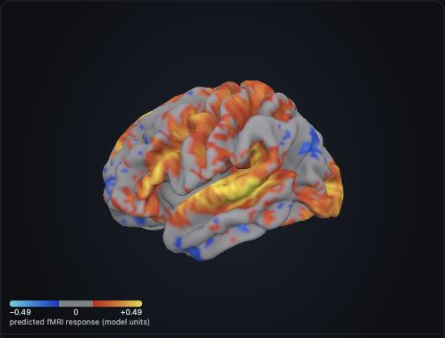

# Neuro: predicted brain response for a take

After a take is transcribed, its words and their timings go through Meta's
[TRIBE v2](https://huggingface.co/facebook/tribev2) model, which predicts the fMRI response an
average listener would have. The results screen then shows a "Brain response" section:

- a **wording meter** from formal to plain and vivid, which is what the prediction tracks,
- the moment with the **strongest predicted response**, with the words spoken there,
- a **3D brain** coloured with the prediction (drag to rotate, play it through the take).

There is deliberately no score out of 100: on real takes the prediction ran against the speaking
score (see Test 3 in [ANALYSIS.md](ANALYSIS.md)).



It is display-only. It does not feed the overall score or the leaderboard.

## What it means, and what it does not

Read [ANALYSIS.md](ANALYSIS.md) before changing any wording in the app.

| Claim | Status |
|---|---|
| The score separates vivid, concrete language from bland language | Supported: 25 of 25 test topics |
| The score needs the words to make sense | No: scrambled word order scores higher (17 of 25) |
| The vividness score fixes that | On the calibration texts only (it was built from them) |
| The score tracks how engaged an audience is | Not supported: r = +0.04 against 21 real listeners |

So the app says "predicted brain response" and "language vividness", never "engagement" or
"attention", and keeps it out of the ranked score, where it could be gamed.

## How it fits together

```
app ── upload ──► backend (FastAPI) ── transcript words + timings ──► neuro API (Modal GPU, TRIBE v2)
                     │                                                    │
 results screen ◄────┴── GET /api/submissions/{id}/neuro  ◄── raw score, ranking, regions, brain map
 3D brain (iframe / web view) ◄── GET /neuro/viewer/index.html?embed=1&result=...
```

| Path | What it is |
|---|---|
| `api/neuro_core.py`, `api/modal_app.py` | The GPU service. `neuro-score` takes word timings; `analyze` takes a video or audio file and transcribes it itself |
| `scoring.py`, `data/reference.json` | Ranks a result against the calibration texts. Runs inside the GPU service |
| `viewer/` | `brain_viewer.js` (three.js module), `index.html` (the page), `fsaverage5_mesh.json` (the brain surface) |
| `../backend/app/neuro.py` | Backend side: sends the transcript, caches the result, never blocks or fails a submission |
| `../src/components/BrainResponse.tsx` | The section on the results screen (`BrainView` is an iframe on web, a web view on iOS and Android) |
| `client.py`, `analyze_video.py` | Command-line check without the app: `python -m neuro.analyze_video clip.mp4` |
| `data/`, `tools/`, `ANALYSIS.md` | The saved calibration and validation results and the scripts that produced them |

## Setup

1. Deploy the GPU service once. It needs a [Modal](https://modal.com) account and a Hugging Face
   token with access to `meta-llama/Llama-3.2-3B`:

   ```bash
   pip install modal && modal setup
   modal secret create huggingface HF_TOKEN=<your token>
   cd neuro/api && modal deploy modal_app.py
   ```

2. Put the `neuro-score` URL it prints in `backend/.env`:

   ```
   NEURO_SCORE_URL=https://<workspace>--neuro-engagement-neuro-neuro-score.modal.run
   ```

   Keep that URL out of the app and out of git: it is unauthenticated and runs on your GPU budget.
   With it unset, the backend reports the feature as disabled and the app hides the section.

3. Restart the backend. Nothing else changes: `POST /api/submissions` starts the prediction as
   soon as the transcript exists, and the results screen picks it up.

## Backend API

`GET /api/submissions/{id}/neuro` (add `?brain=false` to leave out the 1 MB brain map)

```jsonc
{ "status": "completed",                    // or "processing" (poll), "unavailable", "disabled"
  "raw": 0.199,
  "ranking": {
    "raw_score":       { "value": 0.199, "percentile": 64, "beats_flat_texts": 100, "beats_vivid_texts": 28, "band": "vivid" },
    "vividness_score": { "value": 0.118, "percentile": 50, "beats_flat_texts": 100, "beats_vivid_texts": 0,  "band": "in between" },
    "networks": { "language": { "percentile": 68 }, "social": { }, "auditory": { }, "default_mode": { } },
    "most_activated_regions": [ { "region": "A5", "role": "auditory association cortex: speech sounds", "activation": 0.437 } ],
    "notes": [ "…caveats to show with the numbers…" ] },
  "peak": { "t": 21, "text": "…words spoken at the strongest moment…" },
  "curve": [0.12, 0.18, …],                 // predicted response per second
  "brain": { "mean": [20484 values], "frames_int8_b64": "…", … } }
```

Timing, measured on a 41-second clip with an A100: 10 to 15 seconds when the GPU is warm, up to
2 minutes from a cold start. The app waits up to 4 minutes, then hides the section.

## Is the brain picture accurate?

It is an accurate picture of the model's prediction. It is not a scan of anyone.

- TRIBE v2 predicts on the fsaverage5 surface: 10,242 left-hemisphere points, then 10,242 right.
  The viewer mesh is that same surface in that same order, so value *i* colours point *i*.
  Nothing is smoothed or interpolated.
- Checked on a real clip: all 20,484 values in the viewer equal the API output exactly, and the
  180 region averages computed inside the viewer equal the server's (largest difference 0.0001,
  from rounding).
- Checked anatomically: with the bundled atlas labels, V1 sits at the back of the brain, A1 on the
  side, motor cortex on top and Broca's area front-left, in both hemispheres.
- Checked against an independent renderer (nilearn, `docs/reference_nilearn.png`): same pattern.
- The page shows the colour scale in use. Weak values are greyed out, not altered.

## Limits and licences

- **TRIBE v2 is CC BY-NC 4.0: non-commercial use only.** That covers anything built on its output.
  The rest of this repository is MIT; this feature is the exception.
- Llama 3.2 (inside TRIBE) is under Meta's Llama licence and needs approved access on Hugging Face.
- The brain surface is FreeSurfer's fsaverage5 (via nilearn); region labels are the HCP-MMP1 atlas
  (Glasser et al., 2016).
- English only. Words and timing only: tone of voice and video are not used.
- The reference texts were spoken at an even 150 words per minute. A take with long pauses will
  rank a little lower for the same words.
- On iOS and Android the 3D brain uses `react-native-webview`. It has been run in the web build;
  the native web view has not been tested on a device yet.
